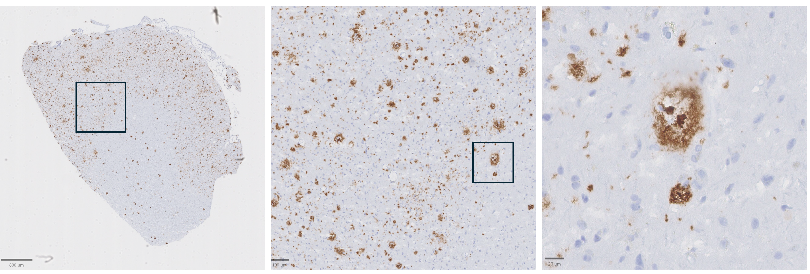
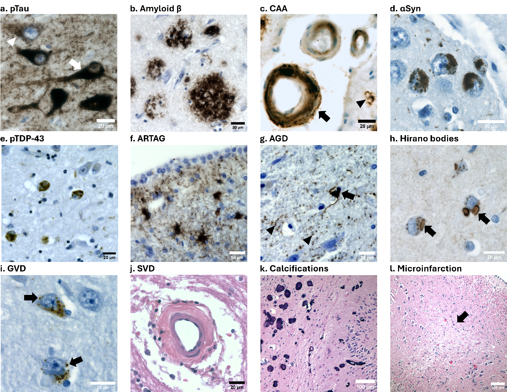
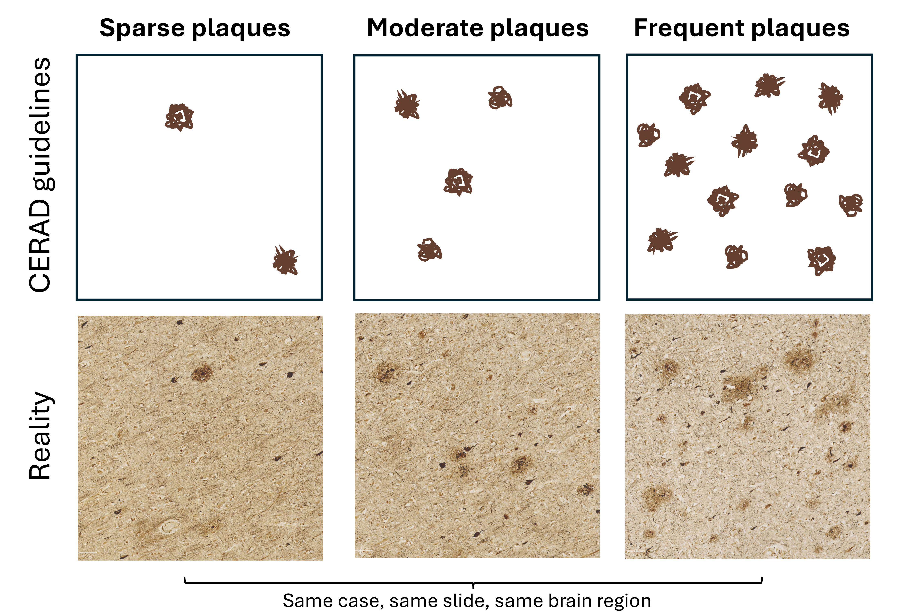

## Learning to see pathology

Humans have evolved a remarkable ability to recognize objects despite substantial variations in their appearance [[1]](#ref-1). We can recognize a familiar object regardless of its orientation, size, color, or lighting conditions, often without even realizing how complex this task is.

However, recognizing objects is still a skill that needs to be developed. At the beginning, you simply do not see certain structures in the brain. Someone points them out to you, and you wonder how they managed to find them in the first place. After looking at similar slides for many consecutive days, you suddenly start detecting things that previously looked like nothing more than noise.

<figure>
  
  <figcaption style="font-size: 0.85em; text-align: center; line-height: 1.5;">
    <strong>Figure 1. Neuropathological examination at different scales.</strong>
    A section of the prefrontal cortex from an individual with Alzheimer's disease,
    immunostained for amyloid-β using the 4G8 antibody to visualize amyloid plaques.
    The same tissue section is shown at different magnifications, from an overview
    of the tissue architecture to individual pathological structures.
      
    Image credit: Jessica S. Sadick and Shane A. Liddelow (2022),
    The Cell Image Library,
    <a href="https://doi.org/10.7295/W9CIL54453">CIL:54453</a>.
    Images cropped from the original whole-slide image and arranged by the author.
    License: <a href="https://creativecommons.org/licenses/by-nc-sa/3.0/">
    CC BY-NC-SA 3.0</a>.
  </figcaption>
</figure>

With experience, we also become better at applying previously acquired knowledge to unfamiliar structures and learning to recognize new types of pathology.

But why is recognizing pathological structures so difficult in the first place?

## Why no two slides look the same

There are numerous sources of variability in histological images, some biological and others introduced during tissue preparation. I will discuss many of them in more detail in separate posts, but for now, here is a brief overview [[2]](#ref-2).

1. **Staining variability.** Some slides will be stained more strongly than others. This applies both to the structures of interest and to the surrounding tissue. Differences in staining intensity, nonspecific background staining, and variations in color can substantially change the appearance of a slide.

2. **Tissue preservation.** The postmortem interval (PMI), the time between death and tissue preservation, storage conditions, type of fixative, and duration of fixation can all influence tissue appearance and the detection of pathological structures.

3. **Anatomical variability and sectioning.** No two tissue sections look exactly the same, even if they originate from the same anatomical region. This is partly due to natural anatomical differences between individuals and partly due to differences in the position and orientation of tissue sectioning.

4. **Artifacts.** Stain deposits, tissue folds, tears, dirt, air bubbles, and imaging artifacts can all interfere with the assessment of pathology. Many of these artifacts we humans quickly learn to recognize and ignore, whereas computers may happily interpret them as objects of interest.

5. **Neurodegeneration.** Degenerating tissue can lose some of the characteristics and anatomical landmarks that help us identify brain regions and cellular structures. Ironically, the tissue we are most interested in studying can also be the most difficult to recognize.

6. **Antibody variability.** Different antibodies targeting the same protein can produce substantially different staining patterns. They may recognize different parts of the protein, different post-translational modifications, or different molecular forms.

7. **Biological variability.** Even within a single brain region, pathology is rarely distributed uniformly. Certain cortical layers, cell populations, or tissue compartments may be particularly vulnerable, while neighboring structures remain relatively unaffected.

<figure>
  
  <figcaption style="font-size: 0.85em; text-align: center; line-height: 1.5;">
    <strong>Figure 2. Variability in tissue appearance.</strong>
    Two hematoxylin and eosin (H&E)-stained cortical sections from individuals with Alzheimer's disease. Differences in tissue appearance do not necessarily reflect differences in the underlying disease but may result from the journey the tissue took before reaching the microscope. Irregular empty spaces visible in the image on the right are likely the result of postmortem changes or tissue processing.
      
    Image credit: Jessica S. Sadick and Shane A. Liddelow,
    The Cell Image Library,
    <a href="https://doi.org/10.7295/W9CIL54487">CIL:54487</a> and
    <a href="https://doi.org/10.7295/W9CIL54467">CIL:54467</a>.
    Images cropped from the original whole-slide images.
    License: <a href="https://creativecommons.org/licenses/by-nc-sa/3.0/">
    CC BY-NC-SA 3.0</a>.
  </figcaption>
</figure>

Many of these problems are common to medical pathology and histology in general. However, I would argue that some of them are particularly pronounced in neuropathology due to the remarkable structural and cellular heterogeneity of the brain.

It can take years to reliably distinguish signal from noise across different types of tissue and pathology. This is one of the reasons why neuropathological expertise is so valuable. What makes translating this expertise into computational methods particularly challenging is that much of this knowledge is acquired through experience. Written guidelines cannot always capture all the exceptions and nuances that an experienced neuropathologist encounters in everyday practice.

And if every image is slightly different and there seem to be more exceptions than rules, how do we develop a robust automated detection pipeline?

Before we get to computers, however, let us look at what we are actually trying to detect and how neuropathologists have traditionally assessed it.

## What are we looking for?

In short, neuropathologists are looking for signs of disease. In the context of neurodegenerative diseases, we can broadly distinguish three categories of pathological changes.

### Neurodegeneration and glial responses

Two particularly interesting aspects of neurodegenerative diseases are the extent of tissue damage and the associated glial responses. These include neuronal loss, changes in tissue architecture, white matter degeneration, and reactive changes in astrocytes and microglia.

Many of these changes can be identified using conventional histological stains, such as hematoxylin and eosin (H&E) or Nissl staining. More specialized staining methods, including immunohistochemistry (IHC), can help visualize specific changes, such as astrocyte reactivity, microglial activation, or myelin loss.

### Pathological protein aggregates

One of the characteristic features of many neurodegenerative diseases is, of course, the abnormal accumulation of proteins or peptides. Examples include amyloid-β, phosphorylated tau, α-synuclein, TDP-43, FUS, and prion protein, among others.

Although the relationship between protein accumulation, neuronal death, and clinical symptoms is complex, these aggregates provide some of the most valuable neuropathological markers of neurodegenerative diseases. They are usually visualized using specialized staining methods, such as immunohistochemistry or silver staining (although you can sometimes spot plaques in H&E!).

### Vascular pathology

Another major category of abnormalities includes changes affecting the brain's blood vessels and blood supply. These include hemorrhages, infarcts (areas of tissue damage caused by insufficient blood supply), structural abnormalities of vessel walls, and the accumulation of proteins within vessel walls.

Some of these changes are visible during macroscopic examination, while others can be identified using conventional histological stains or more specialized staining methods. Vascular pathology frequently coexists with neurodegenerative pathology and can independently contribute to cognitive impairment [[3]](#ref-3).

<figure>
  
  <figcaption style="font-size: 0.85em; text-align: center; line-height: 1.5;">
    <strong>Figure 3. Examples of neuropathological changes in the aging human brain.</strong>
    (A) Neurofibrillary tangles (arrows), pretangles (arrowhead), and dystrophic neurites.
    (B) Amyloid-β plaques.
    (C) Cerebral amyloid angiopathy affecting arterioles (arrow) and capillaries (arrowhead).
    (D) Neuronal α-synuclein aggregates.
    (E) TDP-43-positive neuronal cytoplasmic inclusions.
    (F) Aging-related tau astrogliopathy (ARTAG).
    (G) Argyrophilic grain disease with coiled bodies (arrow) and grains (arrowhead).
    (H) Hirano bodies (arrows).
    (I) Granulovacuolar degeneration bodies (arrows).
    (J) Arteriolosclerosis.
    (K) Vascular calcifications.
    (L) Microinfarct (arrow).
      
    Source: Reproduced from the author's
    <a href="https://lirias.kuleuven.be/4233812">doctoral dissertation</a>,
    Gawor (2025), KU Leuven <a href="#ref-4">[4]</a>, where detailed staining and anatomical information
    can be found.
  </figcaption>
</figure>

Of course, this is a simplified classification, and these categories are not mutually exclusive. Other neuropathological findings include Hirano bodies, corpora amylacea, granulovacuolar degeneration, and tissue calcifications. Other disease processes, such as infections or tumors, may also coexist with neurodegenerative changes.

## Pathology has been identified. What now?

When characterizing pathological changes, there are generally three questions of interest:

- **What are they?** What morphological changes are present in the tissue? Which proteins accumulate, and in what molecular forms?
- **How much is there?** Are there just a few pathological structures, or is the entire region severely affected? To what extent are cells and tissue structures damaged?
- **Where are they?** Which brain regions are affected? Is the pathology in gray or white matter? Is it intracellular or extracellular? Does it affect neurons, glial cells, or blood vessels?

One approach is simply to describe the observed changes. Written reports remain one of the most important documents produced by neuropathologists. However, free-text descriptions can vary between neuropathologists, and translating them into standardized data suitable for large-scale research is not always straightforward.

Over the past few decades, considerable efforts have been made to standardize neuropathological assessment. Consensus guidelines and classification systems have been developed for many neurodegenerative diseases, including Alzheimer's disease [5], [6], Lewy body disease [7], [8], [9], and frontotemporal lobar degeneration [10], [11]. Depending on the disease, these guidelines provide recommendations on which brain regions to examine, which staining methods to use, what pathological structures to look for, and how to assess them.

Although the specific criteria differ between diseases, many rely on similar approaches to describing and measuring pathological changes. Let us go through them one by one.

<figure>
  
  <figcaption style="font-size: 0.85em; text-align: center; line-height: 1.5;">
    <strong>Figure 4. Overview of approaches to neuropathological assessment.</strong>
    Methods range from manual qualitative and semiquantitative assessments
    to quantitative and computational approaches.
    Illustration by the author.
  </figcaption>
</figure>

## It looks mild to me

The simplest approach is to establish whether pathology is present or absent. This is known as a **binary assessment**. Depending on the pathology and the criteria being used, a minimum number of lesions may be required to classify a region as positive.

However, knowing that something is present does not necessarily tell us much about its abundance. To overcome this limitation, neuropathologists frequently perform a **semiquantitative assessment**, assigning pathology to categories such as:

- None (0)
- Mild (1)
- Moderate (2)
- Severe (3)

Depending on the pathology and the guidelines being followed, additional categories or different terminology may be used.

But what exactly does *moderate* mean?

In many situations, the assessment relies on a combination of established criteria, visual reference examples, and previous experience. Essentially, does it look mild, moderate, or severe to you, considering all the examples of this particular pathology that you have previously encountered?

This is not necessarily a bad approach. Experienced neuropathologists can integrate a remarkable amount of visual and biological information into a relatively quick assessment. However, communicating and reproducing that assessment is not always straightforward.

## What exactly does moderate plaque density mean?

Let us consider one of the best-known examples of semiquantitative assessment in neuropathology: the criteria developed by the Consortium to Establish a Registry for Alzheimer’s Disease (CERAD). Published in 1991, these guidelines aimed to standardize the neuropathological assessment of Alzheimer's disease and included reference images illustrating different densities of neuritic plaques [[12]](#ref-12), which I have tried to represent schematically below.

<figure>
  
  <figcaption style="font-size: 0.85em; text-align: center; line-height: 1.5;">
    <strong>Figure 5. Semiquantitative assessment of neuritic plaque density.</strong>
    Top: schematic illustrations of sparse, moderate, and frequent neuritic plaques,
    drawn by the author based on the CERAD criteria presented in
    <a href="https://doi.org/10.1212/WNL.41.4.479">Mirra et al. (1991)</a>,
    Figure 2.
    Bottom: three fields from the same Bielschowsky silver-stained section
    of the prefrontal cortex of an individual with Alzheimer's disease,
    illustrating spatial variability in plaque density.
      
    Microscopy image credit: Jessica S. Sadick and Shane A. Liddelow,
    The Cell Image Library,
    <a href="https://doi.org/10.7295/W9CIL54480">CIL:54480</a>.
    Images cropped from the original whole-slide image.
    License: <a href="https://creativecommons.org/licenses/by-nc-sa/3.0/">
    CC BY-NC-SA 3.0</a>.
  </figcaption>
</figure>

The approach makes intuitive sense: neuropathologists compare the observed pathology with reference images and assign the most appropriate category. However, things become more complicated when we consider the spatial variability of pathology.

The three microscopy images above give quite different impressions of plaque density. The catch? All three originate from the same tissue section.

Which image best represents the severity of pathology in this region? Should the assessment reflect the average plaque density, the most severely affected area, or an area considered representative?

The CERAD criteria focus on the areas of highest neuritic plaque density in the neocortex. However, identifying these areas, recognizing neuritic plaques, and estimating their density can still introduce variability between observers. CERAD investigators themselves addressed interlaboratory variability in 1994 [[13]](#ref-13).

Can we assume that everyone has interpreted these guidelines in exactly the same way over the past few decades? Probably not.

This is particularly important when comparing or combining neuropathological data from different laboratories.

## Where rather than how much: neuropathological staging

Another commonly used approach to neuropathological assessment is **staging**.

Many neurodegenerative diseases are characterized by relatively stereotypical patterns of anatomical involvement, with pathology thought to appear in certain brain regions earlier than in others. Rather than measuring exactly how much pathology is present in each brain region, staging uses information about its anatomical distribution to estimate how far the pathological process has progressed.

Examples include:

- Thal phases of amyloid-β deposition [[14]](#ref-14).
- Braak stages of neurofibrillary tau pathology in Alzheimer's disease [[15]](#ref-15).
- Braak stages of Lewy pathology in Parkinson's disease [[16]](#ref-16).
- Staging of tau pathology in progressive supranuclear palsy (PSP) [[17]](#ref-17).
- Staging of cerebral amyloid angiopathy (CAA) [[18]](#ref-18).
- Staging of limbic-predominant age-related TDP-43 encephalopathy neuropathological change (LATE-NC) [[19]](#ref-19).

Several of these staging systems are important components of contemporary neuropathological diagnostic criteria. They also provide a relatively time-efficient way of assessing pathology. Rather than examining every brain region, neuropathologists can examine a selection of regions that are informative about different stages of the pathological process.

Some protocols even recommend a stepwise approach: if pathology is absent from selected screening regions, additional staining may not be necessary [[6]](#ref-6).

This is a very practical approach, although it comes with limitations. Staging systems are largely based on observations across different individuals rather than direct observations of pathological progression within the same individual. Moreover, two individuals assigned to the same stage can differ substantially in the amount of pathology present in individual brain regions.

And, of course, there are always cases that refuse to fit neatly into our classification systems.

## Can we simply count everything?

An alternative to assigning pathology to broad categories is **manual counting**. For example, pathological inclusions can be counted, and their density expressed as the number of inclusions per square millimeter of tissue.

Interestingly, the 2012 National Institute on Aging–Alzheimer's Association (NIA-AA) guidelines for the neuropathological assessment of Alzheimer's disease provide numerical examples of neuritic plaque densities corresponding to different CERAD categories [[6]](#ref-6). This provides a more explicit reference for interpreting the categories, although the final CERAD score remains semiquantitative.

However, manually counting pathological structures across large tissue sections and multiple brain regions is extremely time-consuming. Things become even more complicated when the objective is to estimate the number of objects in three-dimensional tissue rather than simply count their profiles in two-dimensional sections.

For this, researchers can use **stereological methods**. Design-based stereology uses systematic random sampling and predefined counting rules to obtain unbiased estimates of properties such as the total number of neurons within a brain region.

Although extremely valuable, these methods require time, expertise, and appropriate tissue sampling. This makes their application to routine neuropathological assessments and large retrospective studies difficult and, in some cases, impossible with the available tissue or staining techniques.

## Can computers help us?

Binary assessments, semiquantitative scores, and staging systems have served neuropathologists well for decades. They allow experienced neuropathologists to extract diagnostically relevant information from complex biological tissue within a reasonable amount of time.

However, the measurements that are sufficient to establish a diagnosis are not necessarily sufficient to answer our research questions.

Between *none* and *severe*, there is an enormous amount of biological information that we are currently not capturing. Ideally, we would like to know not only how much pathology is present, but also what these pathological structures look like, where exactly they are located, which cells are affected, and how they relate to other pathological changes.

We would also like to assess these changes across many more brain regions and individuals than is practically possible with manual approaches.

Could computers help us extract this information without spending the next few decades counting pathological inclusions under a microscope?

This is where computational neuropathology comes into play, and where things start to get particularly interesting.

## References

1.  DiCarlo JJ, Zoccolan D, Rust NC. How does the brain solve visual object recognition? *Neuron*. 2012;73(3):415–434. [doi:10.1016/j.neuron.2012.01.010](https://doi.org/10.1016/j.neuron.2012.01.010).

2.  Taqi SA, Sami SA, Sami LB, Zaki SA. A review of artifacts in histopathology. *J Oral Maxillofac Pathol*. 2018;22(2):279. [doi:10.4103/jomfp.JOMFP_125_15](https://doi.org/10.4103/jomfp.JOMFP_125_15).

3.  Skrobot OA, et al. Vascular cognitive impairment neuropathology guidelines (VCING): the contribution of cerebrovascular pathology to cognitive impairment. *Brain*. 2016;139(11):2957–2969. [doi:10.1093/brain/aww214](https://doi.org/10.1093/brain/aww214).

4.  Gawor K. *Heterogeneity of Alzheimer's disease: co-pathologies, APOE ε4, and hippocampal degeneration*. Doctoral dissertation. KU Leuven; 2025. [LIRIAS4233812](https://kuleuven.limo.libis.be/discovery/fulldisplay?docid=lirias4233812&context=SearchWebhook&vid=32KUL_KUL:Lirias&lang=en&search_scope=lirias_profile&adaptor=SearchWebhook&tab=LIRIAS&query=any,contains,LIRIAS4233812&offset=0).

5.  Hyman BT, et al. National Institute on Aging–Alzheimer's Association guidelines for the neuropathologic assessment of Alzheimer's disease. *Alzheimers Dement*. 2012;8(1):1–13. [doi:10.1016/j.jalz.2011.10.007](https://doi.org/10.1016/j.jalz.2011.10.007).

6.  Montine TJ, et al. National Institute on Aging–Alzheimer's Association guidelines for the neuropathologic assessment of Alzheimer's disease: a practical approach. *Acta Neuropathol*. 2012;123:1–11. [doi:10.1007/s00401-011-0910-3](https://doi.org/10.1007/s00401-011-0910-3).

7.  McKeith IG, et al. Diagnosis and management of dementia with Lewy bodies: third report of the DLB Consortium. *Neurology*. 2005;65(12):1863–1872. [doi:10.1212/01.wnl.0000187889.17253.b1](https://doi.org/10.1212/01.wnl.0000187889.17253.b1).

8.  McKeith IG, et al. Diagnosis and management of dementia with Lewy bodies: fourth consensus report of the DLB Consortium. *Neurology*. 2017;89(1):88–100. [doi:10.1212/WNL.0000000000004058](https://doi.org/10.1212/WNL.0000000000004058).

9.  Attems J, et al. Neuropathological consensus criteria for the evaluation of Lewy pathology in post-mortem brains: a multi-centre study. *Acta Neuropathol*. 2021;141:159–172. [doi:10.1007/s00401-020-02255-2](https://doi.org/10.1007/s00401-020-02255-2).

10.  Mackenzie IR, et al. Nomenclature and nosology for neuropathologic subtypes of frontotemporal lobar degeneration: an update. *Acta Neuropathol*. 2010;119(1):1–4. [doi:10.1007/s00401-009-0612-2](https://doi.org/10.1007/s00401-009-0612-2).

11.  Mackenzie IR, et al. A harmonized classification system for FTLD-TDP pathology. *Acta Neuropathol*. 2011;122(1):111–113. [doi:10.1007/s00401-011-0845-8](https://doi.org/10.1007/s00401-011-0845-8).

12.  Mirra SS, et al. The Consortium to Establish a Registry for Alzheimer's Disease (CERAD). Part II. Standardization of the neuropathologic assessment of Alzheimer's disease. *Neurology*. 1991;41(4):479–486. [doi:10.1212/WNL.41.4.479](https://doi.org/10.1212/WNL.41.4.479).

13.  Mirra SS, et al. Interlaboratory comparison of neuropathology assessments in Alzheimer's disease: a study of the Consortium to Establish a Registry for Alzheimer's Disease (CERAD). *J Neuropathol Exp Neurol*. 1994;53(3):303–315. [doi:10.1097/00005072-199405000-00012](https://doi.org/10.1097/00005072-199405000-00012).

14.  Thal DR, Rüb U, Orantes M, Braak H. Phases of Aβ-deposition in the human brain and its relevance for the development of AD. *Neurology*. 2002;58(12):1791–1800. [doi:10.1212/WNL.58.12.1791](https://doi.org/10.1212/WNL.58.12.1791).

15.  Braak H, Braak E. Neuropathological stageing of Alzheimer-related changes. *Acta Neuropathol*. 1991;82:239–259. [doi:10.1007/BF00308809](https://doi.org/10.1007/BF00308809).

16.  Braak H, et al. Staging of brain pathology related to sporadic Parkinson's disease. *Neurobiol Aging*. 2003;24(2):197–211. [doi:10.1016/S0197-4580(02)00065-9](https://doi.org/10.1016/S0197-4580(02)00065-9).

17.  Kovacs GG, et al. Distribution patterns of tau pathology in progressive supranuclear palsy. *Acta Neuropathol*. 2020;140:99–119. [doi:10.1007/s00401-020-02158-2](https://doi.org/10.1007/s00401-020-02158-2).

18.  Thal DR, Ghebremedhin E, Orantes M, Wiestler OD. Vascular pathology in Alzheimer disease: correlation of cerebral amyloid angiopathy and arteriosclerosis/lipohyalinosis with cognitive decline. *J Neuropathol Exp Neurol*. 2003;62(12):1287–1301. [doi:10.1093/jnen/62.12.1287](https://doi.org/10.1093/jnen/62.12.1287).

19.  Nelson PT, et al. Limbic-predominant age-related TDP-43 encephalopathy (LATE): consensus working group report. *Brain*. 2019;142(6):1503–1527. [doi:10.1093/brain/awz099](https://doi.org/10.1093/brain/awz099).

## Useful resources

- [The Cell Image Library](https://www.cellimagelibrary.org/) — A publicly accessible repository of microscopy images, including the brain tissue images used in this post. You can download and explore whole-slide images from Alzheimer's disease cases! Simply download the submitted data (beware, the files are large!) and open the images in [QuPath](https://qupath.github.io/), a free, open-source software for digital pathology.
- [Neuropathology Atlas – Washington University](https://neuropathologyatlas.wustl.edu/) — An extensive collection of over 33,000 annotated neuropathological images, covering a wide range of brain disorders, including neurodegenerative diseases.
- [NACC Neuropathology Forms and Coding Guidebook](https://www.naccdata.org/data-forms-and-documentation/neuropathology-np-v11/) — A good example of how neuropathological observations, including semiquantitative assessments and staging, are translated into standardized research data.